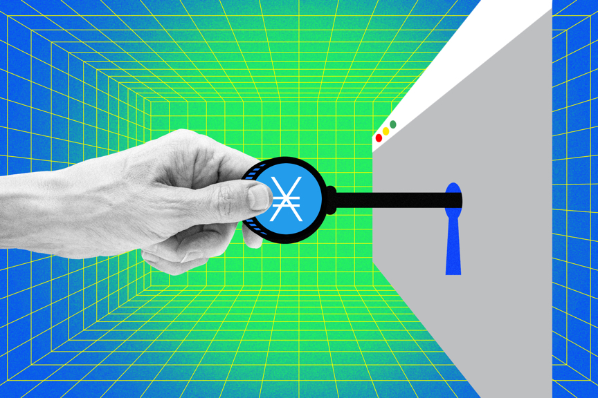

- title: Introducing NanoPay.js - Web Payments Made Easy
- date: 01-30-2024
- tags: Release
- image: images/nano-pay/hero.png
- author: @nano2dev
- single: true
- pay_demo: true
- address: @development
- goal: 500|NanoPay + eCommerce
-----

## Edit on CodePen

[https://codepen.io/nano2dev/pen/VwRQypE](https://codepen.io/nano2dev/pen/VwRQypE)

## Introduction

Inspired by Apple Pay ™, NanoPay is a [open source](https://github.com/fwd/nano-pay), non-custodial javascript library for the Nano blockchain. 

Easily accept crypto payments on your website(s) with this package. 

## Installation

First, add NanoPay to your project's *index.html*.

**CDN:**
```html
<script src="https://cdn.nano.to/pay.js"></script>
```

**Local:**
```html
<script src="/NanoPay.js"></script>
```

Download [latest](https://cdn.nano.to/pay.js) version.

## Simple Usage

Simple payments can be achieved with basic HTML. No javascript required. 

```html
<a 
data-title="Tip @Nano2Dev" 
data-amount="0.133" 
data-address="@development" 
data-button="Open Natrium" 
data-position="bottom">
Tip 0.133 NANO</a>
```

<button class="nano-pay-button" type="button" onclick="window.NanoPay.open({ title: 'Tip @Nano2Dev', address: '@development', amount: 0.0001, button: 'Open Wallet', position: 'bottom', cancel: function () { console.log('User cancelled') }})">Try the simple payment</button>

## Javascript API

Configure and open popup programmatically with *NanoPay.open()* method.

```javascript
NanoPay.open({ 
  title: "Demo",
  address: '@development', // Username or Nano Address
  notify: 'support@nano.to', // get an email receipt
  contact: true, // user's email
  shipping: 10, // user's shipping address, use 'true' for free shipping
  currency: 'EUR', // converts prices EUR, default USD
  // amount: 30, // not used if using line_items
  line_items: [
    { name: "Shirt (X-Small)", price: 50 }, 
    { name: "Mens Shoes (9.5)", price: 20 }
  ],
  success: (block) => {
      console.log(block)
      // {
      //     "hash": "D16FF348B634CDB3DF8...9D6F5B180CCD3B93F99A4D15203",
      //     "amount": "NANO_AMOUNT_PAID",
      //     "address": "PAYEE_NANO_ADDRESS",
      //     "username": "PAYEE_USERNAME",
      //     "height": "PAYEE_BLOCK_HEIGHT",
      //     "shipping": "PAYEE_SHIPPING_ADDRESS",
      //     "email": "PAYEE_EMAIL_ADDRESS",
      //     "nanolooker": "https://nanolooker.com/block/D16FF348B634CDB3DF8...9D6F5B180CCD3B93F99A4D15203"
      //     "checkout": "https://api.nano.to/checkout/93be1ab9",
      // }
  },
  cancel: () => {
      console.log("User cancelled")
  },
})
```

<button class="nano-pay-button" type="button" onclick="window.NanoPay.open({ title: 'Demo Order', address: '@development', amount: 0.0001, line_items: [{ name: 'Shirt (X-Small)', price: 0.0001 }, { name: 'Mens Shoes (9.5)', price: 0.0002 }], button: 'Open Wallet', cancel: function () { console.log('User cancelled') }})">Try the line-item checkout</button>

## All Options

- **title**: (*string*) Show custom title shown in popup.
- **address**: (*string*) Nano address or Nano.to @Username.
- **contact**: (*string*) User's email address.
- **shipping**: (*number or bool*) User's mailing address. 'true' for free shipping.
- **position**: (*string*) Control popup position (top, center, bottom).
- **wallet**: (*string*) Custom wallet icon: natrium, nault, nautilus, cake
- **button**: (*string*) Custom button text, default "Open Natrium".
- **symbol**: (*string*) Custom NANO symbol, default "NANO".
- **random**: (*bool*) Use unique payment amounts, default true.
- **notify**: (*string*) Send email notification to admin, default false.
- **amount**: (*string*) Custom popup amount, used for simple payments.
- **line_items**: (*array*) List of products user is buying, replaces amount.
- **currency**: (*string*) Fiat currency for Nano price conversion, default "USD".
- **note**: (*string*) Custom note shown in admin email, default false.
- **qrcode**: (*string*) Always show QR Code, default desktop only.
- **success**: (*function*) Called when payment is successful.
- **cancel**: (*function*) Called when popup is cancelled.
- **checkout**: (*string*) Use custom Nano.to Checkout. [Read More](https://rpc.nano.to/#checkout).
- **email**: (*string*) Pre-configure user's email
- **mailing_address**: (*string*) Pre-configure user's shipping address

## Notifications

NanoPay offers email notifications for your convenience. 

```javascript
NanoPay.open({ 
  address: '@bank', // Username or Nano Address
  notify: 'support@nano.to',
  contact: true,
  shipping: true,
  amount: 0.133
})
```

<button class="nano-pay-button" type="button" onclick="window.NanoPay.open({ title: 'Email and Shipping Demo', address: '@development', notify: 'support@nano.to', contact: true, shipping: true, amount: 0.0001, button: 'Open Wallet', cancel: function () { console.log('User cancelled') }})">Try email and shipping</button>


## Login with Nano

NanoPay makes Login with Nano easy. 

```js
NanoPay.open({ 
  title: "Login",
  address: '@bank', // Your App's Address
  amount: 0.0001, // Small Amount
  success: (block) => {
      // {
      //     "hash": "D16FF348B634CDB3DF8...9D6F5B180CCD3B93F99A4D15203",
      //     "address": "PAYEE_NANO_ADDRESS",
      //     "username": "PAYEE_USERNAME",
      //      ...
      // }
      console.log("Hello:", block.username || block.address)
  }
})
```

<button class="nano-pay-button" type="button" onclick="window.NanoPay.open({ title: 'Login with Nano', address: '@development', amount: 0.0001, button: 'Open Wallet', success: function (block) { console.log('Authenticated payment:', block && (block.username || block.address)) }, cancel: function () { console.log('User cancelled') }})">Try Login with Nano</button>

## HTML Content Paywall



NanoPay includes an easy way to monetize any website client-side. 

> Please note, this method does not require a back-end, as such it's not for keeping secrets from public. Google bots can still crawl content.

```html
<style>
/* This css prevents flash of content on page load */
.premium { display: none; } 
</style>
<article class="premium">
  Premium content is hidden until the payment is completed.
</article>
```

```js
NanoPay.wall({ 
    element: '.premium',
    title: 'Read Story',
    button: 'Unlock Story', 
    free: true, // Allow free reading
    amount: 0.001, // Cost of Article
    address: '@development', // Your Nano Address or Username
    success: (block) => {
      // do stuff like render highlight.js
      console.log("Thanks for reading:", block.username || block.address)
    }
})
```

<button class="nano-pay-button" type="button" onclick="window.NanoPay.wall({ element: '#nano-pay-example-wall', title: 'Read Story', button: 'Unlock Story', free: true, amount: 0.0001, address: '@development', success: function (block) { console.log('Paywall unlocked:', block) }})">Enable the paywall demo</button>
<div id="nano-pay-example-wall" class="nano-pay-example-wall">Premium content protected by the paywall.</div>

**I work on Nano part-time. Please consider helping fund this kind of work. Anything helps.**

[funding]

## Nano.to Support

Bugs, Questions & Installation Support:

- Github: [Source Code](https://github.com/fwd/nano-pay)
- Issues: [Issues](https://github.com/fwd/nano-pay/issues)
- Support: [support@nano.to](mailto:support@nano.to)
- Twitter: [@nano2dev](https://twitter.com/nano2dev)
- Mastodon: [Xno.Social](https://xno.social/@nano2dev)
- @nano2dev on [Nano's Discord](https://discord.com/invite/RNAE2R9) 
